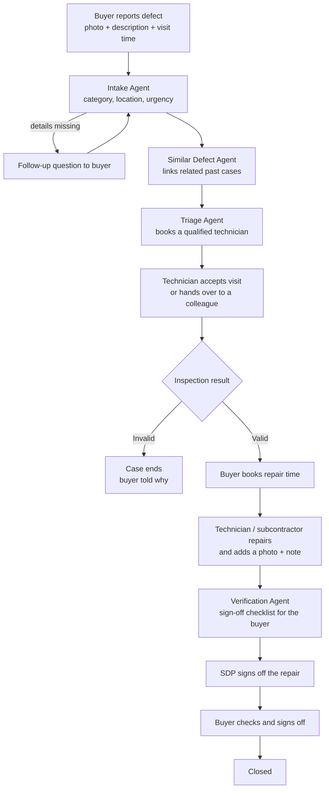
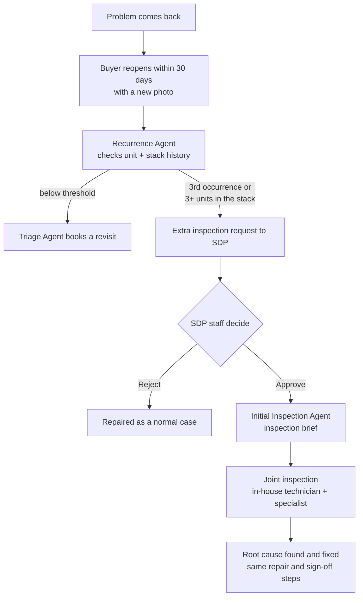

# 3. Flow

## Normal case: report to sign-off

Every step writes an event to the case timeline, and the **Comms Agent** sends the buyer an update in the app
and by email.

| Step | Status |
|---|---|
| Report submitted / details missing | `SUBMITTED` / `INFO_NEEDED` |
| Technician picked, then accepted | `ASSIGNED` → `VISIT_SCHEDULED` |
| Inspection result | `VALID` or `INVALID` (final) |
| Repair booked, then done | `REPAIR_BOOKED` → `REPAIRED` |
| Waiting for sign-off, then closed | `PENDING_SIGNOFF` → `CLOSED` |

**Sign-off rules:** SDP signs first, then the buyer has 14 days, with a reminder 3 days before the deadline.
If the buyer doesn't respond, the case closes automatically (high-urgency cases are flagged to SDP instead).

## Recurring defect: reopen and escalation

| Step | Status |
|---|---|
| Buyer reopens | `REOPENED` |
| Waiting for SDP approval | `ESCALATION_PENDING` |
| Approved, brief attached | `EXTRA_INSPECTION` |

The escalation request is a recommendation: **SDP staff always make the decision.**
